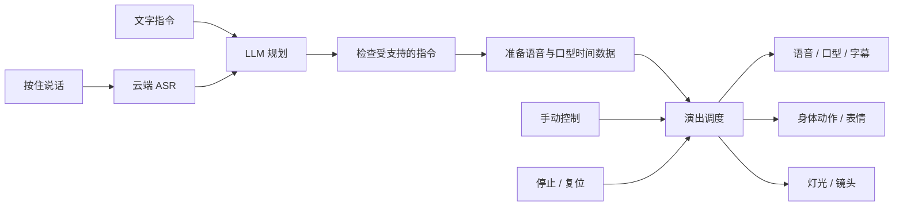

# Design: 可被现场指挥的 3D 数字主持人 Demo

Generated by /office-hours on 2026-10-21
Branch: demo
Status: DRAFT
Mode: Builder
Scope: 本文档和后续产物均位于 `qiuqiu/demo/` worktree。

## Problem Statement

用户目前没有详细需求，希望先做出可以演示的数字 agent：用语音指挥一个 3D 数字人，让它回应、做动作，并协调舞台变化，以实际演示帮助形成下一阶段需求。

## What Makes This Cool

观众说“抬手欢迎大家，再把灯光调成蓝色”，主持人理解这句话，开口欢迎、抬手招呼，灯光随表演变化。旁边的字幕和控制区让演示者看清发生了什么，并能随时停止或复位。

## Decisions and Premises

- 采用路线 A：复用 TalkingHead 组件，开发专用演示页面与演出调度；用户已在 D8 选择 A。
- 首版为一个网页，包含一个角色、一个 3D 舞台、字幕和简易控制区；先完成约 90 秒的互动演示。
- 人物和动作素材采用明确的开放许可；ASR（语音转文字）、LLM（理解与规划）、TTS（文字转语音）允许使用云端 API。
- 用户没有硬截止时间，按可展示的阶段成果推进；先验证完整流程和停止、复位，再提升外观精度与动作数量。
- 表演通过预设动作库完成。LLM 选择受支持的动作，程序检查参数并负责执行与同步。
- 本轮仅产出设计和布局线框；可选的 Claude Code 第二意见由用户在 D7 选择跳过。最终设计审阅单独记录。

## Approaches Considered

| 路线 | 取舍 |
| --- | --- |
| A：TalkingHead 组件复用 | 已选；已有角色、手势和镜头控制接近当前目标，新增工作集中在演示体验与调度。 |
| B：Three.js + three-vrm 自建 | 本轮未选；自由度更高，但需要补齐更多语音、口型和动作基础能力。 |
| C：裁剪 AIRI | 本轮未选；有完整语音与角色链路，但需先理解较大代码库，并适配专用舞台。 |

以上路线判断基于官方文档调研，尚未进行安装、账号可用性、兼容性或性能实测。

## Recommended Approach

前端采用 TypeScript，使用 TalkingHead 的角色与场景能力；新增简洁的舞台、字幕、手动控制和演出调度。设置一个本地 Node.js 服务代理云端调用，长期 API 密钥保存在服务端的本地环境变量中。界面框架及精确依赖版本在工程计划中确定，TalkingHead 与其 Three.js 依赖固定为相互兼容的版本。

### 数据与控制流

### 首版能力与输入约定

- 页面首次进入时由用户点击“进入表演台”，解锁音频播放并检查角色资源；麦克风权限在使用语音输入时请求。
- 拟采用按住说话、松开发送的轮流交互，另提供文字输入。当前轮处理或演出时暂停接受下一条指令；“停止”和“复位”始终可用。该交互随本文整体审批确认。
- 首批动作采用候选人物能支持的 `handup`（抬手招呼）、`index`（指向）和 `thumbup`（赞同）；表情为中性和开心。这里的招呼是抬手动作，挥手循环需额外动作验证。
- 灯光预设为暖色、蓝色、白色；镜头预设为全身、半身、近景。手动按钮走同一套执行入口，并在当前轮结束或停止后使用。
- 语音按钮、识别文本、主持人字幕、当前状态都在页面可见。角色风格、性别和音色尚未确定，初期人物作为兼容性样本。

### 组件与素材验证

| 部分 | 首选验证对象 | 验证内容与处理 |
| --- | --- | --- |
| 角色驱动 | TalkingHead | 核查固定版本的角色、手势、语音、停止和镜头接口，先复用现有场景；独立角色模式在文档中仍标为实验功能，不作为首版前提。 |
| 人物 | 官方示例 `mpfb.glb` | 上游说明标为 CC0；下载时保存具体文件、来源和许可证据，再确认骨骼与嘴部形变满足要求。 |
| 身体动作 | TalkingHead 内置三种手势 | 先避免额外动画重定向。扩展动作时可评估 Quaternius CC0 动画，但需要另做骨骼适配验证。 |
| 语音 | Azure Speech 作为首个 ASR/TTS 候选 | 文档支持中文识别与中文口型数据；具体账号、区域、音色、接口和权限尚待核实。首轮先验证短句，不先做完整流式链路。 |
| 语言模型 | 支持结构化工具调用的云模型，优先评估 Qwen | 使用支持工具调用的具体模型版本做小样验证；账号及可用模型尚未确定，保持服务适配边界。 |

TalkingHead 的 MIT 代码许可不能替代人物和动画许可。引入资源时建立素材清单，逐项记录来源、文件版本或哈希、许可、署名要求及骨骼适配结果。模型的 API 调用费用和账号开通由用户控制，本轮不创建账号、不产生调用费用。

### 中文口型：先验证，再扩展

优先验证选定 TTS 接口实际返回的语音与口型时间轴，保存原始时间数据及服务嘴形到角色嘴形的明确映射。口型单位（viseme）表示嘴形，服务端与角色库使用的嘴形编号或名称需要映射，不能直接假定一致；按实际播放音频的时钟驱动嘴形和字幕。

M0 的三句样本覆盖不同发音和停顿，例如“欢迎各位来到今天的演示现场”“爸爸妈妈，大家好”“请把蓝色灯光打开，停一下，再向前看”。回放时对照时间数据、映射和录屏，检查嘴形变化是否对应正在播放的语音、停顿时能否收嘴、是否出现明显持续错位；仅有嘴巴开合或任意变化不算通过。保存检查结论和不通过样本，由用户确认视觉效果是否足够用于第一轮演示。

若首选语音接口无法提供可用数据，M0 只调整音色、接口或映射方案，并记录原因。仍不通过时暂停完整语音集成，向用户展示样本与备选路径；不把“嘴巴随音量开合”标成中文口型验证通过。HeadAudio 可作为后续音频驱动口型候选，但其官方说明明确指出精度局限，需要用户观察比较。

### 演出调度

LLM 输出简短回复、动作/表情/灯光/镜头请求，以及无法处理的请求列表。执行前按明确的枚举和参数范围检查；模型不能输出任意场景代码、命令或资源路径。

首版采用整轮接受或整轮拒绝：如果一条指令同时包含受支持与未支持的请求，或返回了非法参数，就不执行本轮任何身体动作、舞台变化或语音播报，仅在页面说明原因和可用替代。例如“灯光调蓝，再跳舞”应提示“跳舞暂未支持，本轮没有更改灯光；可以只说‘灯光调蓝’”。M2 用该句验证模型能识别未支持意图，不能仅以输出格式合法判为成功；模型漏掉未支持部分仍算识别失败。

一次接受一轮指令，每轮分配独立编号。先完成规划、参数检查及所需语音准备，再开始演出；默认在语音实际开始时触发手势和舞台变化，后续如确有节目需要，再增加更多时间点。

页面顶层状态为加载、待机、录音、识别、规划、演出、可恢复错误。演出中语音与身体动作可以并行，均结束后才回到待机；单独的手动灯光或镜头指令完成后立即回到待机。

- **停止**：取消本轮录音或请求、清空待播放内容、停止本轮声音和动作、恢复闭嘴与待机姿态；保留现有灯光、镜头及对话文字。取消后迟到的响应按轮次编号丢弃。
- **复位**：先停止，再恢复默认灯光、全身镜头、中性表情，并清空本次对话上下文和显示文字。API 配置和素材文件保持原状。
- **ASR 失败或识别为空**：本轮不进入规划、不开始表演；显示“未能识别，请重新录音或输入文字”，保留可用的文字输入，并允许重新录音。失败轮随后到达的回调仍按轮次规则丢弃。
- **规划或 TTS 失败**：本轮不开始计划中的身体动作和舞台变化；显示失败原因及重试入口。纯手动舞台控制仍可使用。
- **执行中失败**：停止剩余音频和动作，保留字幕并标注未完成，进入可恢复错误。可由停止或复位回到可操作状态。

### 界面布局

左侧约三分之二为舞台，字幕位于舞台底部；右侧为语音与文字输入、动作和舞台控制。顶部显示待机、正在听、准备中、正在表演等状态；停止和复位固定可见。参见[可切换状态的布局线框](digital-host-demo-wireframe/sketch.html)和[表演状态截图](digital-host-demo-wireframe/perform.png)，是设计示意，未接入真实数字人或云服务。

## 演示脚本草案

| 段落 | 演示者操作 | 预期表现 |
| --- | --- | --- |
| 入场 | 进入表演台 | 角色待机；默认灯光、全身镜头、输入可用。 |
| 欢迎 | “抬手欢迎大家，介绍一下自己。” | 短句回应、字幕、口型和抬手招呼共同出现，结束后待机。 |
| 导演指令 | “灯光调蓝，镜头拉到半身，指一下前方。” | 执行三个受支持的变化，并给出简短回应。 |
| 即兴变化 | “赞一下今天的观众。” | 生成现场台词并使用赞同手势；同义表达仍映射到已有动作。 |
| 接管与收尾 | 表演中点击停止，再点击复位 | 声音与动作结束，旧响应不再恢复；复位后能再次开始。 |

整段目标约 90 秒，台词长度与等待时间在彩排后调整。具体动作和外观以 M0 验证结果为准。

## Next Steps and Success Criteria

下列数字为拟定验收目标，不是已测得的表现；正式验收前记录目标电脑、浏览器版本、音频设备和网络环境。

| 阶段 | 工作与交付 | 通过条件 |
| --- | --- | --- |
| M0：人物与中文口型 | 一个许可明确的候选人物，三段中文语音、嘴形映射和三种手势的验证记录 | 使用实际 TTS 时间轴及明确映射，按“中文口型”节逐句检查语音与嘴形对应、停顿和持续错位；仅有嘴形变化不算通过。三个动作不破模、不残留姿态，结束后回待机。保存时间数据、映射、录屏与用户听看结论。未通过先处理兼容性。 |
| M1：手动表演台 | 舞台、字幕区域、动作、灯光、镜头、停止和复位 | 不接 LLM 即可手动操作三种身体动作、灯光和镜头，并能停止/复位。语音、口型和字幕先沿用 M0 的固定样本回放作调试验证，现场生成与正式输入在 M2 接通。资源失败与麦克风拒绝有清晰提示，文字输入在 M2 接通后可代替录音。 |
| M2：语音与规划 | 云端 ASR/LLM/TTS 适配，指令检查和轮次状态 | 10 条支持指令（含两条同义表达）至少 9 条完整正确；手动修改识别结果算人工辅助，不计为自动成功。不支持或非法指令整轮拒绝；另用“灯光调蓝，再跳舞”验证拒绝说明与舞台保持原状。 |
| M3：调度与恢复 | 播放同步、取消与迟到响应处理 | 在录音、识别、规划、演出阶段分别停止，均不再执行旧轮内容。点击停止后目标为声音在 0.5 秒内停止、姿态在 1 秒内回待机；需要实测并记录。 |
| M4：彩排与交付 | 约 90 秒演示脚本、运行说明和已知问题 | 连续完成三轮演示，无需刷新页面；覆盖权限拒绝、ASR 失败/空识别、规划失败、TTS 失败、连续点击和复位后重试。ASR 失败后不规划、不表演，提示可重新录音或输入文字，并实际完成一次恢复。记录每次恢复结果。 |

M2 开始测量“松开发送 → 首段语音实际开始”的端到端耗时，区分首次资源准备和预热后运行；预热后的 20 次固定短指令，拟定目标为中位数不超过 4 秒、90 分位不超过 8 秒。保留失败次数和样本，不能通过删掉慢请求或改用录音冒充现场结果。若不达标，先定位 ASR、规划、TTS 与播放阶段耗时，再调整方案并更新验收记录。

## Dependencies and Open Questions

- 需要一个可用的中文 ASR/TTS 账号，以及支持工具调用的 LLM 账号；用户可提供已有服务的名称，不在聊天中粘贴密钥。具体服务、区域和音色在 M0 核实。
- 角色外观与声音偏好、演示电脑的实际表现、最终观众与投屏需求尚未明确；这些信息影响美术与交付形式，当前以本机桌面浏览器演示为设计基线，随本文审批确认。
- API 调用费用尚未估算；在首次真实调用前，根据选定服务的当期价格与演示脚本给出用量估算，由用户决定是否调用。
- 轮流说话和按钮停止是拟定首版交互。自动插话、连续开放麦克风、多角色、完整舞蹈节目、长期记忆和公开多用户服务留待后续明确需求。
- M0 若无法获得合适的合法素材或可用中文口型链路，必须先回报结果并重新讨论，不在既定路线下无限适配。

## Distribution Plan

首版在 `qiuqiu/demo/` 本地启动，浏览器访问本机地址，可投屏演示；本地服务默认仅绑定回环地址。运行说明需要列出依赖、环境变量名称、启动命令、素材来源与重置方式。长期密钥仅由服务端使用，前端接收演出所需数据；实际音频上传及服务错误不写入公共仓库。

当前仓库没有远程地址与 CI/CD。首版不建立发布流水线；公开访问、托管、认证、并发与发布流程在用户提出分享需求时另行设计。工程阶段再建立与实际工具匹配的构建和验证命令。

## Effort and Practical Limits

此前用于比较的粗估是人工独立开发 3–5 个工作日，AI 辅助开发与人工验收 1–2 个工作日。它假定素材兼容且云账号可用，尚无实测依据，不作为交付承诺；M0 后重新评估。人工听看、账号授权和现场彩排仍需要用户参与。

## The Assignment

下一步先完成 M0 的验证材料：用同一候选人物演示一句中文欢迎词、三种手势及一次停止，并展示给用户看。用户只需指出“最不像主持人的一个瞬间”，据此决定优先改声音、口型、动作还是舞台。该任务等待本文批准及后续实施授权后执行，本轮不编写应用代码。

## What I noticed about how you think

- 你说“没有明确的详细的需求信息”，同时提出“先做一个可以演示的 demo”；本方案因此用可展示的场景帮助需求成形。
- 你选择了同页舞台和控制区、允许云端 API，也同意先验证完整流程再完善外观；这些选择使第一轮可以集中验证现场互动是否成立。

## Sources

资料核查日期：2026-10-21。以下文档支撑组件能力或许可说明，不能代替 M0 的运行与兼容性验证。

- [TalkingHead 官方仓库与接口、素材说明](https://github.com/met4citizen/TalkingHead)
- [Azure Speech 中文与口型支持](https://learn.microsoft.com/en-us/azure/ai-services/speech-service/language-support?tabs=tts#visemes)
- [Azure 口型事件与音频时间偏移](https://learn.microsoft.com/en-us/azure/ai-services/speech-service/how-to-speech-synthesis-viseme)
- [Qwen 工具调用说明](https://help.aliyun.com/zh/model-studio/qwen-function-calling)
- [Quaternius Universal Animation Library](https://quaternius.com/packs/universalanimationlibrary.html)
- [three-vrm](https://github.com/pixiv/three-vrm)
- [AIRI](https://github.com/moeru-ai/airi)
- [HeadAudio 精度说明](https://github.com/met4citizen/HeadAudio)

<!-- gstack:office-hours:concerns:start -->
## Reviewer Concerns

Disposition: COMPLETED

Stop: PASS

No unresolved findings.
<!-- gstack:office-hours:concerns:end -->
