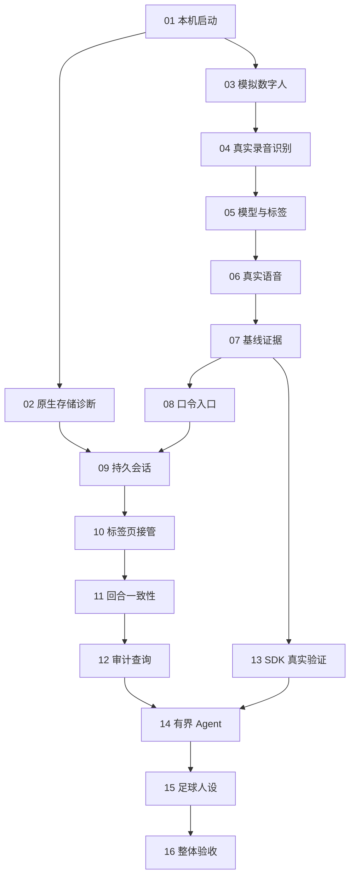

# 足球数字人基线与 M0 拆票草案

共 16 票、103 个细项。每票各有独立文件，包含交付行为、前置依赖、规格与用户故事映射、验收条件、细节步骤、验证接缝和范围边界。

当前状态为 **local implementation**：用户已确认粒度、依赖和测试接缝，并授权 goal/implement；尚未发布到 issue tracker，未使用 ready-for-agent 标签。上一级任务清单是实施进度唯一来源，逐票文件负责验收描述；本地文件名保留 draft 以区别外部工单。

## Proposed breakdown

1. **[从干净环境启动本机诊断服务](01-local-startup.md)**
   - **Blocked by:** 无
   - **What it delivers:** 维护者依照说明安装并启动本机服务，看到健康状态；缺少本阶段必需配置时，在调用云接口前得到清晰错误。

2. **[验证原生持久存储与向量扩展](02-native-storage-diagnostics.md)**
   - **Blocked by:** #01
   - **What it delivers:** 维护者通过诊断命令写入、重启并读回记录，分别看到 SQLite 和 1024 维向量查询结果，并能识别迁移失败。

3. **[在浏览器演示可见可听的数字人闭环](03-visible-simulated-conversation.md)**
   - **Blocked by:** #01
   - **What it delivers:** 浏览器加载官方 VRM，通过明确标注的模拟回答演示声音、当前句字幕、基础口型和四个动作，形成后续接真接口的可见起点。

4. **[把真实录音变成可验证的识别文本](04-microphone-to-transcript.md)**
   - **Blocked by:** #03
   - **What it delivers:** 用户点击开始、结束并发送，服务器将合法音频交给真实 ASR，页面在当前字幕区域展示识别结果；录音失败时能重试。

5. **[让真实模型回答并解析演出标签](05-streamed-reply-and-tags.md)**
   - **Blocked by:** #04
   - **What it delivers:** 用户的真实识别文本进入基础对话模型，流式回复被整理成有顺序的句子、表情与动作；当前字幕可读且不会泄露控制标签。

6. **[接通冰糖音色与完整语音演出](06-real-voice-playback.md)**
   - **Blocked by:** #05
   - **What it delivers:** 用户的真实语音经过识别和模型生成后，以真实冰糖音色逐句播放；字幕、嘴部和动作跟随正在播放的句子。

7. **[形成可重跑的基线验收和延迟报告](07-baseline-evidence.md)**
   - **Blocked by:** #06
   - **What it delivers:** 演示者能重跑一组固定对话，对照声音、字幕与动作效果，并获得本机真实基线的原始样本和统计结果。

8. **[用共享口令保护本机连接入口](08-local-token-handshake.md)**
   - **Blocked by:** #07
   - **What it delivers:** 正常浏览器按配置自动连入，缺少或错误口令的连接在升级时被拒绝，且不会创建会话或调用云服务。

9. **[刷新和重启后继续各自的会话](09-persistent-browser-conversation.md)**
   - **Blocked by:** #02、#08
   - **What it delivers:** 新会话播放一次开场白，随后完成的问答持久保存；同一浏览器刷新或服务重启后续聊，两个浏览器各自保持上下文。

10. **[新标签页接管会话并停止旧页重连](10-single-active-page.md)**
   - **Blocked by:** #09
   - **What it delivers:** 同浏览器的新标签页继续原会话，旧页停止录音与播放并显示“会话已在其他页面继续”，不会反复抢回连接。

11. **[保证完整回合提交、取消与重提的一致性](11-atomic-turn-and-cancellation.md)**
   - **Blocked by:** #10
   - **What it delivers:** 刷新、接管、合成失败或重复请求时，用户之后只会看到完整已保存的问答；旧任务不能迟到提交或再次播放。

12. **[按会话和回合查询结果、失败与耗时](12-turn-audit-and-metrics.md)**
   - **Blocked by:** #11
   - **What it delivers:** 维护者用查询命令找到某轮输入、回答、状态和耗时；数据库是终态依据，附加 JSONL 写入失败不会让用户已完成的问答重做。

13. **[实测 SDK 与 MiMo 的工具流兼容性](13-real-sdk-tool-spike.md)**
   - **Blocked by:** #07
   - **What it delivers:** 维护者运行一个有退出条件的真实诊断，看到模型调用时间探针、收到结果并形成最终回复，获得是否采用 SDK 的可复核结论。

14. **[让数字人完成最多三次工具尝试后的回答](14-bounded-agent-integration.md)**
   - **Blocked by:** #12、#13
   - **What it delivers:** 用户询问时间时看到查询状态，随后听到由真实工具结果支持的回答；失败或持续要求工具也能在有界流程内收尾。

15. **[让足球人设与当前能力保持一致](15-football-persona.md)**
   - **Blocked by:** #14
   - **What it delivers:** 用户可以与小糖聊足球背景，询问实时比分等内容时得到诚实的能力说明，同时保留短句、冰糖音色与原有演出。

16. **[完成本机完整 M0 验收与交接](16-integrated-m0-acceptance.md)**
   - **Blocked by:** #15
   - **What it delivers:** 演示者按统一清单运行完整 M0，能复核双浏览器隔离、续聊、接管、异常恢复、真实工具和延迟差异，并获得准确的交付状态。

## Dependency graph

## Review points

- 粒度是否适合逐票交付；需要合并或继续拆分的票可按编号指出。
- 依赖是否都属于真正的前置条件；第 02 与第 03、第 13 与第 08 分别允许并行推进。
- 主测试接缝是否符合预期：真实 WS＋真实临时数据库＋可控外部云；浏览器及真实云结果单独验证。
- 项目未配置追踪器：正式发布前明确载体，或先运行 /setup-matt-pocock-skills 完成配置。需求和变更内容继续以 OpenSpec 为准。

## Traceability

| 需求 | 覆盖票 |
|---|---|
| AC-01 | #01、#08 |
| AC-02 | #08 |
| AC-03 | #08 |
| AC-04 | #08、#12 |
| AG-01 | #13、#14 |
| AG-02 | #14 |
| AG-03 | #13、#14 |
| AG-04 | #13、#14、#15 |
| AG-05 | #15 |
| AG-06 | #05、#15 |
| AG-07 | #13、#14 |
| AG-08 | #13、#14、#16 |
| DH-01 | #03 |
| DH-02 | #04、#06、#11 |
| DH-03 | #04 |
| DH-04 | #05、#06 |
| DH-05 | #03、#05、#06 |
| DH-06 | #03、#06 |
| DH-07 | #03、#04、#06、#10、#11 |
| DH-08 | #07、#16 |
| OB-01 | #12 |
| OB-02 | #12、#14 |
| OB-03 | #12 |
| OB-04 | #07、#12 |
| OB-05 | #07、#16 |
| OB-06 | #12 |
| OB-07 | #07、#16 |
| PC-01 | #09 |
| PC-02 | #09 |
| PC-03 | #09 |
| PC-04 | #10 |
| PC-05 | #09、#11 |
| PC-06 | #11 |
| PC-07 | #10、#11 |
| PC-08 | #09、#11 |
| PC-09 | #09 |
| RT-01 | #01、#16 |
| RT-02 | #01 |
| RT-03 | #02 |
| RT-04 | #02 |
| RT-05 | #02 |
| RT-06 | #01、#03、#07、#13、#16 |

所有 US-01—US-42 用户故事均在逐票文件中映射。条目映射用于发现遗漏，不代表要求已经实现或验收通过。
